  <picture>
    <source media="(prefers-color-scheme: dark)" srcset="assets/banner-dark.svg">
    <source media="(prefers-color-scheme: light)" srcset="assets/banner-light.svg">
    
  </picture>

  
  
  
  

### `~/heretic`

<table>
<tr>
<td>
<b><a href="https://lenoreslate.com/heretic">Heretic</a></b> &nbsp;working title 
A turn-based isometric RPG, built from scratch in Rust and Bevy. Written one system at a time.  
Now: <b>M04 · Living enemies</b> — field of view, patrol and spotting behaviour trees, combat AI  

</td>
</tr>
</table>

### `~/upstream`

<table>
<tr>
<td width="50%" valign="top">
<b><a href="https://github.com/boykopovar/AnyPS5">AnyPS5</a></b> 
Runs PS5 executables natively on Linux and Windows, without emulation. I send pull requests, with a focus on the JavaScript input mapper. 
C++ · CMake · Vulkan · JavaScript  

</td>
<td width="50%" valign="top">
<b><a href="https://github.com/hydralauncher/hydra">Hydra Launcher</a></b> 
An open-source game launcher: library, profiles, cloud saves, achievements and an embedded BitTorrent client. I send pull requests. 
TypeScript · Electron · React · Python · Rust  

</td>
</tr>
</table>

### `~/projects`

<table>
<tr>
<td width="50%" valign="top">
<b><a href="https://github.com/LenoreSlate/SoundCloud-Switcher">SoundCloud Switcher</a></b> 
Chrome and Firefox (Manifest V3) extension to switch between SoundCloud accounts in one click. 
TypeScript · Manifest V3 · AES-GCM · Playwright  

</td>
<td width="50%" valign="top">
<b><a href="https://github.com/LenoreSlate/HydraGTAV_wrapper">HydraGTAV Wrapper</a></b> 
Invisible Rust wrapper for accurate GTA V Enhanced playtime tracking in Hydra Launcher. 
Rust · Windows · Rockstar Games Launcher  

</td>
</tr>
<tr>
<td width="50%" valign="top">
<b><a href="https://github.com/LenoreSlate/HydraR6_wrapper">HydraR6 Wrapper</a></b> 
Lightweight, invisible Rust wrapper to track Rainbow Six Siege playtime on Hydra Launcher. 
Rust · Windows · Ubisoft  

</td>
<td width="50%" valign="top">
<b><a href="https://github.com/LenoreSlate/hydra_sync_gui">Hydra Sync GUI</a></b> &nbsp;archived 
Standalone GUI that detects, matches and syncs Epic, GOG Galaxy and Steam libraries into Hydra Launcher. 
JavaScript  

</td>
</tr>
</table>

### `~/toolbox`

### `~/now`

- Open-source tools made by and for communities
- Isometric RPGs, and learning how to build them
- Learning Rust and C#

  Most of what I'm building is in progress. Follow along on <a href="https://github.com/LenoreSlate?tab=repositories">my repositories</a> or read the <a href="https://lenoreslate.com/">system logs</a>.

